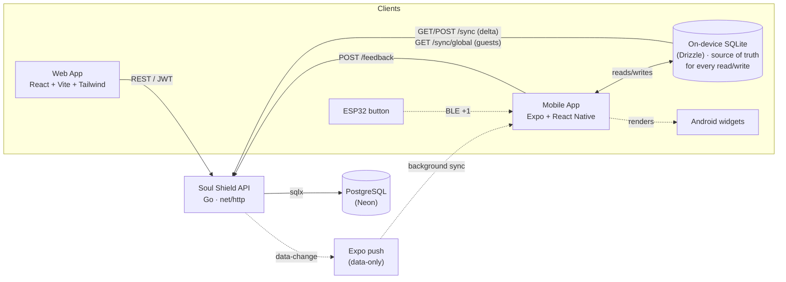
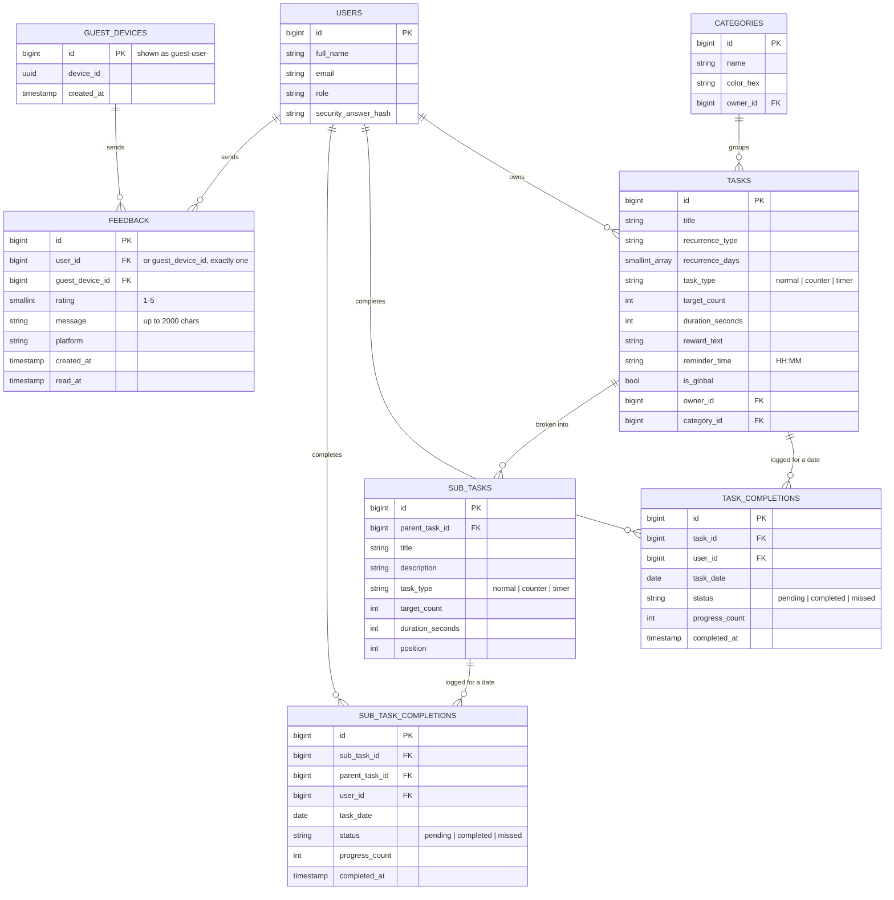

<div align="center">

# 🛡️ Soul Shield

**Your Daily Steps Towards Jannah**

A full-stack habit & task tracker for building consistent daily worship and self-improvement routines — with a Go REST API, a React web dashboard, a local-first Expo mobile app, and an optional ESP32 Bluetooth counter button.

[](soul-shield)
[](soul-shield-client)
[](soul-shield-mobile-app)
[](#-database)
[](LICENSE)

</div>

---

## Contents

- [Live demo](#-live-demo)
- [Overview](#-overview)
- [Features](#-features)
- [What's new](#-whats-new)
- [Architecture](#%EF%B8%8F-architecture)
- [Tech stack](#-tech-stack)
- [Monorepo structure](#-monorepo-structure)
- [API reference](#-api-reference)
- [Database](#%EF%B8%8F-database)
- [Getting started](#-getting-started)
- [Tests & CI](#-tests--ci)
- [Deploying a release](#-deploying-a-release)
- [Known limitations](#%EF%B8%8F-known-limitations)
- [Roadmap](#%EF%B8%8F-roadmap)
- [License](#-license)

## 🔗 Live Demo

| | Link |
|---|---|
| 📑 API / Swagger Docs | [https://soul-shield-api.onrender.com/swagger/index.html](https://soul-shield-api.onrender.com/swagger/index.html) |
| 🌐 Website | [https://soul-shield.vercel.app/](https://soul-shield.vercel.app/) — try it without an account via **Take a tour** |
| 🤖 Android App (APK) | [SoulShield-v2.0.0.apk](https://github.com/Farhan0140/_Soul_Shield/releases/tag/v2.0.0) |

## 📖 Overview

Soul Shield helps you build and keep daily routines — dhikr, prayers, reading, or any recurring habit — by tracking completion, celebrating streaks with custom reward messages, and nudging you with a reminder if you forget.

| Part | Folder | What it is |
|---|---|---|
| **Mobile app** | `soul-shield-mobile-app` | The daily driver. Local-first (works fully offline), **no account needed**, reminders, timers, analytics, Android home-screen widgets, ESP32 Bluetooth counter. |
| **Web dashboard** | `soul-shield-client` | Desktop-friendly task management, history, categories, and the **admin panel** (fixed tasks, ratings & feedback). |
| **API** | `soul-shield` | One Go service both clients talk to, backed by PostgreSQL. |
| **Firmware** | `Framework/`, `Framework-ESP32-DevModule/` | PlatformIO projects for an ESP32-C3 / ESP32 Dev Module button that adds +1 to the active counter over Bluetooth. |

## ✨ Features

### Tasks

- 🔁 **Flexible recurrence** — daily, weekly, or custom day-of-week schedules
- ✅ **Three task types** — simple **checkbox** tasks, tally-style **counter** tasks (e.g. "recite 100x"), and duration-based **timer** tasks (e.g. "study 30 minutes")
- ⏱️ **Timer tasks** — start / pause / resume a countdown that completes the task at zero, with a running notification and a completion notification even while the app is in the background or closed. A **Complete** button finishes it early (you did the work but forgot to start the timer); both paths share the same completion, reward and sync logic, so a task can't be completed twice
- 🧩 **Sub-tasks** — break any task into an unlimited list of Normal, Counter or Timer sub-tasks (each with an optional description), added from the task form. Once a task has sub-tasks:
  - it can't be checked off directly — its status (`pending` → `partially_completed` → `completed`) comes from how many sub-tasks are done that day;
  - its reward fires once, when every sub-task is complete;
  - sub-tasks share the parent's recurrence and have no reminder of their own.
- 📂 **Paginated & collapsible sub-tasks** — incomplete sub-tasks 2 per page; completed ones collapse into a "Completed Sub-Tasks" section
- 🎁 **Custom reward messages** shown the moment a task is completed
- 🗂️ **Categories** with custom colors (HSV color picker + hex input)
- ↕️ **Reorder** tasks, sub-tasks and categories
- 🗄️ **Archive & restore** — hide tasks without losing their history
- ⧉ **Duplicate task** — one-tap copy including sub-tasks and reminder
- 🔍 **Offline search** — find any task by title or description and jump to its next scheduled day
- 🔒 **Only today counts** — past and future days are read-only in both clients, so progress can't be back- or forward-dated

### Fixed tasks (admin-managed)

- 📌 Admins publish **fixed tasks** that every user sees — including guests without an account
- 🗃️ **Grouped by category** (mobile + web): the Fixed Tasks page shows one collapsible group per admin category, with a task count on each header. If there's only one group it opens automatically
- ➕ **Add to my tasks** — copy any fixed task into your own list, then edit it freely

### Mobile app

- 📱 **Local-first** — an on-device SQLite store (Drizzle ORM) is the source of truth for every read and write. Any date works fully offline; edits apply instantly and are queued for sync
- 👤 **No account needed (guest mode)** — the whole app works without signing in. An account is only for cloud backup and sync across devices. When a guest signs in, their local data is kept and uploaded into the account; categories with the same name are merged instead of duplicated
- ⏰ **Reminder notifications** per task, plus a daily reminder setting and a "send test notification" check
- 📈 **7-Day Progress chart** — fully vs partially completed days, updated on every tap and sync
- 🔥 **Streaks & milestones** — day-streak chip on Home with one-time celebrations (3/7/14/30/100…)
- 🧭 **Insights** — 30/90-day completion rate, best streak, favorite category, most productive weekday, and **Share Progress** as an image
- 📊 **History** — completion heatmap and per-day breakdown
- 🟦 **Android home-screen widgets**
  - **Soul Shield — Today**: today's progress bar, completed / remaining counts, and the next tasks
  - **Soul Shield — Bluetooth Counter**: the counter the ESP32 button is driving, with its progress
- ⌨️ **Keyboard-aware screens** — when the keyboard opens, the field you're typing in scrolls up and stays above it, on every screen and pop-up sheet (sign-in, task and category forms, search, feedback, counter and duration inputs). Works the same on Android (edge-to-edge) and iOS
- ⭐ **Rate & feedback** — see [Ratings & feedback](#ratings--feedback)
- 🛍️ **Shop** — placeholder page ("Coming soon")
- 🌍 **English + বাংলা**, 10 theme palettes, 3 UI styles (**Normal**, hand-drawn **Paper** and **Pencil**), Arabic font picker, daily verse
- 🎉 Haptics (with an on/off preference), confetti on rewards, first-run onboarding

### Web dashboard

- 🗓️ Dashboard for today's tasks with counters, timers (dedicated timer page) and reward pop-ups
- 📊 History over any date range, categories and category detail pages
- 👤 Profile: change password, delete account
- 🧪 **Take a tour** — an in-browser demo with sample data (no account, nothing sent to the server)
- 🎨 Animated UI (Framer Motion), light/dark theme, mobile bottom navigation

### Admin panel (web)

- 📌 **Fixed Tasks** page — create and edit the tasks every user gets, grouped by category
- 💬 **Feedback** page (sidebar) — every rating and message from the mobile app, newest first, with **Load older** paging
  - **Rating summary**: average score and a 1–5 star breakdown, counting **one vote per person** (their latest rating)
  - Each entry shows the stars, message, sender (account name + email, or `guest-user-N`), platform and time; unseen entries are tagged **New**
- 🔔 **In-site notification** — the sidebar shows an unread badge and a toast appears when new feedback arrives (checked every 60 s and when the tab regains focus). Opening the Feedback page marks everything as read
- 📈 Usage stats across all users (`GET /admin/stats`)

### Ratings & feedback

- At the bottom of **Profile → Rate & feedback** in the mobile app: tap 1–5 stars, optionally write a message (up to 2000 characters), send
- Works **signed in or as a guest**. Guests are identified by a random ID kept on the phone and appear to admins as `guest-user-1`, `guest-user-2`, …
- **One submission per person every 24 hours**, enforced by the server (per account or guest device) and shown in the app up front ("You can send again in 5 h 20 min"), so nobody types a message that then gets refused
- Each person counts **once** in the star totals: rating again replaces their earlier vote
- Submissions are also rate-limited per IP (10 per hour)

### Sync & reliability

- 🔄 **Delta sync** (`GET`/`POST /sync`) — the app pulls only what changed since its last cursor and pushes queued edits keyed by client-generated UUIDs. Counter taps from two devices are **summed** on the server instead of overwriting each other, and a real conflicting edit is logged (both versions kept) instead of silently dropped
- 🛰️ **Silent cross-device sync** — edit on the web and the server sends your phone a data-only push (nothing is shown); the phone syncs in the background, even if the app was closed
- 🌙 **Daily background sync** — also finishes timer tasks that ran out while the app was closed. Background tasks are registered from the app entry (`index.ts`), so they work on headless launches
- ⏳ **Resilient** — pushes retry with backoff through a cold-starting backend (e.g. a sleeping Render instance); a **Syncing… / Synced / Sync failed** indicator shows every pull and push
- ⚡ **Instant startup** from the on-device cache, never blocked on the API
- 🩺 **Sync Issues screen** — failed requests, rejected edits and conflicts in plain language
- ✈️ **Offline banner + logout guard** — always says what's online/offline and protects unsynced changes

### ESP32 Bluetooth counter button

- 🔋 Pair once from a counter page's Bluetooth icon; after that a physical button adds **+1** to the selected counter — even with the app in the background or the screen locked
- Works for Counter Tasks **and** Counter Sub-Tasks; switch the active counter from any counter page
- Buzzer and LED feedback on the device, kept in sync with the task's state in the app
- Firmware + flashing guide in `Framework/` (ESP32-C3) and `Framework-ESP32-DevModule/` (classic ESP32)

### Accounts & security

- 🔐 JWT authentication with 14-day sliding sessions
- 🔑 Security-question password reset (no email round-trip)
- 🔁 Change password while signed in (signs out every other session) and self-service account deletion (web + mobile)
- 🚦 Rate limiting on login, registration, password reset and feedback (429 + `Retry-After`)
- 👤 Role-based access (`user` / `admin`)

## 🆕 What's new

Recent changes, newest first:

- **Faster taps and navigation (mobile)** — checkbox and +1 taps show instantly; the follow-up refresh of charts, streak and history runs right after, once per burst of taps. Widgets re-render once per burst instead of twice per tap. Heavy screens (category, insights, task create/edit, reorder) appear on the tap with a skeleton and fill in after the open animation. Local reads no longer expire every 30 s, and reconnecting no longer re-reads screens that aren't open. A new on-device migration (v4) adds date indexes to the completion tables
- **Keyboard handling (mobile)** — inputs are never hidden by the keyboard. Android apps on Expo SDK 54 are edge-to-edge, so Android no longer resizes the screen for the keyboard; the app now uses [`react-native-keyboard-controller`](https://github.com/kirillzyusko/react-native-keyboard-controller) (set up by `<KeyboardProvider>` in `app/_layout.tsx`) to scroll the focused field above the keyboard on every screen and pop-up sheet
- **Standalone Focus Timer removed** (Profile → Tools → Timer). Timer **tasks** are unchanged. On first launch after updating, the app clears anything the old timer left behind (a pinned "Timer running" notification, a pending "Time is up" alert, its saved state and its notification channel)
- **Ratings & feedback** — stars + message from Profile (guests included), admin Feedback page with summary, unread badge and toast, one submission per person per 24 hours
- **Fixed tasks grouped by category** with collapsible groups (mobile + web)
- **Guest mode** — the mobile app works fully without an account; signing in later uploads the guest's data. Fixed tasks for guests come from the public `GET /sync/global`
- **Android widgets redesigned** (Today + Bluetooth Counter) and fixed so they no longer render blank
- **`GET /health`** readiness check (server + database), next to the existing `GET /healthz` liveness probe
- **Shop** page with a "Coming soon" placeholder
- Removed: the mobile **Export My Data (JSON)** option and the visible cross-device sync alerts (syncing itself still happens silently in the background)

## 🏗️ Architecture



## 🧰 Tech Stack

| | Backend (`soul-shield`) | Web (`soul-shield-client`) | Mobile (`soul-shield-mobile-app`) |
|---|---|---|---|
| Language | Go 1.25 | JavaScript (React 19) | TypeScript (React Native 0.81, React Compiler) |
| Framework | `net/http` + `ServeMux` | Vite 8 + React Router | Expo SDK 54 + Expo Router 6 |
| Data | PostgreSQL (Neon) via `sqlx` + `pgx` | — | On-device SQLite (`expo-sqlite` + Drizzle ORM), local-first; TanStack Query for UI cache / mutation queue |
| Auth | `golang-jwt` | JWT stored client-side | `expo-secure-store` |
| Styling | — | Tailwind CSS 4 | `StyleSheet` + themed components |
| Motion | — | Framer Motion | React Native Reanimated 4 |
| Keyboard | — | — | `react-native-keyboard-controller` |
| Migrations | `sql-migrate` (run on startup) | — | — |
| Docs | Swagger / OpenAPI (`swaggo`) | — | — |
| Notifications | Expo push (data-only sync pings) | — | `expo-notifications` (local reminders + timer notifications) |
| Background work | — | — | `expo-background-task` + `expo-task-manager` |
| Bluetooth | — | — | `react-native-ble-plx` (ESP32 counter button) |
| Widgets | — | — | `react-native-android-widget` |
| Hardware | ESP32-C3 / ESP32 (Arduino BLE) | — | — |

## 📂 Monorepo Structure

```
Soul_Shield/
├── soul-shield/                   # Go REST API
│   ├── cmd/                       # entrypoint / server bootstrap
│   ├── config/                    # env-driven configuration
│   ├── infra/db/                  # DB connection + migration runner
│   ├── migrations/                # sql-migrate up/down scripts (000001 … 000005_feedback)
│   ├── repo/                      # data access layer (+ integration tests)
│   ├── rest/handlers/             # HTTP handlers, grouped by domain
│   │   └── user/ task/ category/ sync/ admin/ feedback/ health/
│   ├── rest/middlewares/          # JWT (required + optional), CORS, logging, role guards
│   ├── util/                      # shared errors, rate limiter, constants
│   └── docs/                      # generated Swagger spec
│
├── soul-shield-client/            # React web dashboard
│   └── src/
│       ├── pages/                 # Dashboard, History, Categories, CategoryDetail, TaskTimer,
│       │                          # Profile, AdminTasks, AdminFeedback, auth pages
│       ├── components/            # TaskCard, Sidebar, MobileBottomNav, ui/, …
│       ├── context/               # Auth, API, feedback-notification providers
│       ├── demo/                  # in-browser demo API + sample data ("Take a tour")
│       └── utils/                 # groupFixedTasks, …
│
├── soul-shield-mobile-app/        # Expo React Native app
│   ├── index.ts                   # entry: registers background tasks, then the router
│   ├── app/                       # file-based routes (expo-router)
│   │   ├── (tabs)/                # home, history, create, categories, profile, admin
│   │   ├── (auth)/                # login, register, reset password
│   │   ├── account/               # change password, delete account
│   │   ├── task/ category/        # create/edit screens, category + fixed-task pages
│   │   ├── counter/ timer-task/   # counter and timer-task pages
│   │   └── insights, search, archived, reorder/, shop, sync-notifications
│   ├── api/                       # REST client (incl. feedback)
│   ├── components/                # task, counter, profile (feedback sheet), ui (TextField,
│   │                              # KeyboardAvoidingScrollView, …)
│   ├── hooks/queries/             # TanStack Query hooks per resource
│   ├── tests/                     # node --test unit tests
│   └── lib/
│       ├── db/                    # Drizzle schema + repos (on-device SQLite store)
│       ├── background-sync/       # delta pull/push, global pull, retry, background tasks
│       ├── bluetooth/             # ESP32 BLE manager (scan/connect/+1 dispatch)
│       ├── widget/                # Android home-screen widget renderer
│       ├── timer-task/            # timer-task state + notifications
│       └── …                      # guest merge, notifications, i18n, insights, network, …
│
├── Framework/                     # ESP32-C3 PlatformIO firmware (counter button)
├── Framework-ESP32-DevModule/     # same firmware for the classic ESP32 Dev Module
└── shared-test-fixtures/          # cases both the Go and TypeScript code are tested against
```

## 🔌 API Reference

Full interactive docs are served at **`/swagger/index.html`** once the backend is running.

**Health**

| Method | Endpoint | Description |
|---|---|---|
| `GET` | `/healthz` | Liveness probe — no database access (use this for Render's health check) |
| `GET` | `/health` | Readiness — server up **and** database reachable |

**Users**

| Method | Endpoint | Description |
|---|---|---|
| `POST` | `/users/register` | Create an account (with security question) |
| `POST` | `/users/login` | Authenticate, receive a JWT |
| `POST` | `/users/verify-security-answer` | Step 1 of password reset |
| `POST` | `/users/reset-password` | Step 2 of password reset |
| `GET` | `/users/me` | Current user |
| `DELETE` | `/users/me` | Permanently delete the account and all of its data (`{password}`; not available to admins) |
| `POST` | `/users/change-password` | `{current_password, new_password}`. Signs out every other session and returns `{message, token}`: store the new token |
| `POST` / `DELETE` | `/users/push-token` | Register / remove this device's push token (silent cross-device sync) |

**Tasks**

| Method | Endpoint | Description |
|---|---|---|
| `POST` | `/tasks` | Create a task, optionally with `sub_tasks` |
| `GET` | `/tasks?date=` | Tasks + status for a given day |
| `GET` | `/tasks/mine` | Your own tasks |
| `GET` | `/tasks/history?from=&to=` | Tasks + status across a date range (at most 366 days) |
| `GET` | `/tasks/stats?days=` | Completion rate, streak, favorite category, best weekday (default 365 days) |
| `GET` | `/categories/{categoryId}/tasks` | Tasks in a category |
| `PATCH` | `/tasks/{id}` | Update a task; `sub_tasks` replaces the sub-task list if provided |
| `PATCH` | `/tasks/reorder` | Save a new task order |
| `DELETE` | `/tasks/{id}` | Delete a task (and its sub-tasks) |
| `POST` | `/tasks/{id}/complete` | Complete a normal or timer task for a date (not for tasks with sub-tasks; no future dates) |
| `POST` | `/tasks/{id}/uncomplete` | Undo a completion (idempotent) |
| `POST` | `/tasks/{id}/increment` | Add progress to a counter task |
| `POST` | `/tasks/{id}/add-to-my-tasks` | Copy a fixed task into your own tasks |
| `POST` | `/tasks/by-uuid/{uuid}/add-to-my-tasks` | Same, by UUID (used by the local-first mobile app) |
| `POST` | `/tasks/{taskId}/subtasks/{subTaskId}/complete` | Complete a normal or timer sub-task |
| `POST` | `/tasks/{taskId}/subtasks/{subTaskId}/increment` | Add progress to a counter sub-task |
| `POST` | `/tasks/{taskId}/subtasks/{subTaskId}/uncomplete` | Undo a sub-task completion |

**Categories**

| Method | Endpoint | Description |
|---|---|---|
| `POST` | `/categories` | Create a category |
| `GET` | `/categories` | List categories |
| `PATCH` | `/categories/{id}` | Update a category |
| `PATCH` | `/categories/reorder` | Save a new category order |
| `DELETE` | `/categories/{id}` | Delete a category |

**Sync**

| Method | Endpoint | Description |
|---|---|---|
| `GET` | `/sync?since=` | Delta pull — every task / category / sub-task / completion changed (including soft-deleted) since the cursor |
| `POST` | `/sync` | Delta push — up to 500 changes (`upsert` / `delete` / `increment`) in one transaction, each returned as `accepted` / `superseded` / `rejected`; counter increments sum; `base_updated_at` enables conflict detection |
| `GET` | `/sync/global` | **Public** — the admin fixed tasks, their sub-tasks and categories, so guests get them without an account |

**Feedback**

| Method | Endpoint | Description |
|---|---|---|
| `POST` | `/feedback` | **Optional auth.** `{rating 1-5, message?, device_id (guests), platform}` → `201 {id}`. A second submission within 24 h returns `429` with `code: "feedback_cooldown"` and `next_allowed_at` |
| `GET` | `/admin/feedback?limit=&before=` | Admins: newest-first list + star summary (one vote per person) + unread count; page with `next_before` |
| `GET` | `/admin/feedback/unread-count` | Admins: unseen feedback count (drives the notification) |
| `POST` | `/admin/feedback/read` | Admins: mark all feedback as seen |

**Admin**

| Method | Endpoint | Description |
|---|---|---|
| `GET` | `/admin/stats?days=` | Usage across all users (default 30 days) |

Fixed tasks are managed by admins through the regular task endpoints (`is_global`).

Authentication: send `Authorization: JWT <token>`. It's required everywhere except registration / login / password reset, `/healthz`, `/health`, `/sync/global` and `/feedback` (optional there).

Request/response conventions:

- **`X-Timezone: <IANA zone>`** (e.g. `Asia/Dhaka`): both clients send it, so "today" (default dates, history ranges, the future-date guard) is the user's day. Without it the server uses UTC and allows dates up to today in UTC+14.
- **Sessions** last 14 days and slide: once a token is a day old, responses carry a renewed one in **`X-Refreshed-Token`**, which clients store. Changing or resetting the password revokes every existing token.
- Request bodies are limited to 1 MiB (413); every response carries an **`X-Request-ID`** that matches the server log line.

## 🗄️ Database



- The parent task's own status (in API responses, never stored) has a fourth value, `partially_completed`, derived from its sub-tasks.
- Every task/category/sub-task/completion table also carries a `uuid` (what the mobile store and `/sync` key on), a soft-delete `deleted_at` and an `updated_at`, omitted from the diagram.
- Also not drawn: `user_push_tokens` (devices to ping for silent sync) and the users' `token_version` (revokes sessions on password change).

## 🚀 Getting Started

### Prerequisites

- [Go](https://go.dev/) 1.25+
- [Node.js](https://nodejs.org/) 20+ (22.18+ to run the mobile unit tests)
- A PostgreSQL database (e.g. a free [Neon](https://neon.tech/) instance)
- Android Studio (or Xcode) for a mobile development build, or an [EAS](https://expo.dev/eas) account

### 1. Backend

```bash
cd soul-shield
cp .env.example .env   # fill in the values below
go run main.go
```

<details>
<summary>Environment variables</summary>

| Variable | Description |
|---|---|
| `SECRETKEY` | **Required.** JWT signing secret (32+ random characters) |
| `CONN_STRING_FOR_DB` | **Required.** Postgres connection URL (e.g. Neon) |
| `HTTPPORT` | Optional, default `3000`. Local port; hosts such as Render set `PORT` instead |
| `CORS_ORIGINS` | Optional. Comma-separated browser origins allowed to call the API (`*` = any). Default: `https://soul-shield.vercel.app` plus the Vite dev/preview ports on localhost |
| `TRUSTED_PROXY_HOPS` | Optional, default `0`. How many reverse proxies append to `X-Forwarded-For`; used to find the real client IP for rate limits (see `util/request.go`). Check your host's header before setting it |
| `VERSION`, `SERVICENAME` | Optional. Informational metadata |
| `TEST_DATABASE_URL` | Tests only. A **disposable** Postgres for `go test ./repo/` (the tests truncate every table) |

</details>

Migrations run automatically on startup (fine for one instance; if the API is ever scaled out, run them once from a release step instead). The server shuts down gracefully on `SIGTERM`, finishing in-flight requests first. Swagger UI: `http://localhost:<HTTPPORT>/swagger/index.html`. After changing handler annotations, regenerate it with `swag init --parseDependency=false`.

### 2. Web client

```bash
cd soul-shield-client
npm install
npm run dev
```

### 3. Mobile app

```bash
cd soul-shield-mobile-app
npm install
npx expo run:android        # builds and installs a development build
npx expo start              # later runs: start the bundler for that build
```

The app needs a **development build**: it uses native modules that **Expo Go doesn't include** (Bluetooth, the Android widgets, the keyboard controller, background tasks). Whenever a native dependency is added (most recently `react-native-keyboard-controller`), rebuild with `npx expo run:android` or `eas build`. A JS-only change only needs the bundler.

### 4. ESP32 counter button (optional)

```bash
cd Framework                       # ESP32-C3 — or: cd Framework-ESP32-DevModule
pio run -t upload                  # flash the firmware
```

Wire a push button between **GPIO4** and **GND**, power the board, then in the app: open any counter task or counter sub-task → tap the **Bluetooth icon** → tap `SoulShield-ESP32` once. Every physical button press now adds **+1** to that counter — background and lock-screen included. Full guide: `Framework/README.md`.

## 🧪 Tests & CI

```bash
cd soul-shield && go test ./...                  # API tests (database tests skip without TEST_DATABASE_URL)
cd soul-shield-mobile-app && npm test            # mobile unit tests (Node 22.18+)
cd soul-shield-mobile-app && npm run typecheck
cd soul-shield-mobile-app && npm run lint
```

`shared-test-fixtures/` holds cases that BOTH the Go and the TypeScript code are tested against (e.g. parent-task status), so the two can't drift apart. Mobile tests cover, among others, the widget renderer (compiled with the React Compiler, like the app), fixed-task grouping, guest merge planning, local-owner switching, cross-device push payloads and input validation.

GitHub Actions (`.github/workflows/ci.yml`) runs on every push:
- **API**: build, vet and tests, including the database integration tests in `soul-shield/repo/integration_test.go` against a throwaway Postgres 16 service;
- **Mobile**: type-check, lint and tests;
- **Web**: lint and build.

Point `TEST_DATABASE_URL` only at a disposable database: those tests truncate every table.

## 📦 Deploying a release

Order matters when a release touches the API:

1. **Backend first** — deploy `soul-shield`; new migrations (e.g. `000005_feedback`) apply on startup.
2. **Web** — deploy `soul-shield-client` (Vercel).
3. **Mobile** — build a new binary with `eas build` (required whenever native dependencies changed, as they did for the keyboard fix).

## ⚠️ Known limitations

- **Single API instance.** Rate limiters and the push-notification debounce live in memory, so they reset on restart and aren't shared between instances.
- **Feedback identity.** An account and the same phone's guest mode count as two different people for the 24-hour feedback limit and the star totals.
- **ESP32 button pairing is not authenticated.** Any nearby phone running the app can connect to the counter button over BLE (the button only sends "+1" taps; it holds no account data).
- **Mobile bundler workaround:** `soul-shield-mobile-app/metro.config.js` aliases `react-native/setup-env` until `@expo/metro-runtime` ships a stable release with the fix (only canary builds after 6.1.2 so far). Remove it then and run `npx expo start --clear`.
- **Removed features:** the Quran bookmark/last-read API and the email-OTP endpoints are gone from the server (their tables are kept; no destructive migration). The mobile Export My Data option and the standalone Focus Timer were removed from the app.

## 🗺️ Roadmap

- [ ] iOS/Android production builds via EAS
- [ ] Shop
- [ ] Push notifications synced across devices (reminder prompts on other devices)
- [x] Use the app without an account (guest mode)
- [x] Ratings & feedback with an admin inbox
- [x] Streaks & long-term progress analytics (Insights screen)
- [x] Shareable progress summaries (Insights → Share Progress)
- [x] Instant sync across devices (edit on web → phones sync in the background)
- [x] ESP32 physical counter button (Bluetooth)

## 📄 License

All rights reserved. The source is public for viewing and contributions only, see [LICENSE](LICENSE).

---

<div align="center">

Built with ☕ and ⌨️ by **[Farhan](https://github.com/Farhan0140)**

</div>
