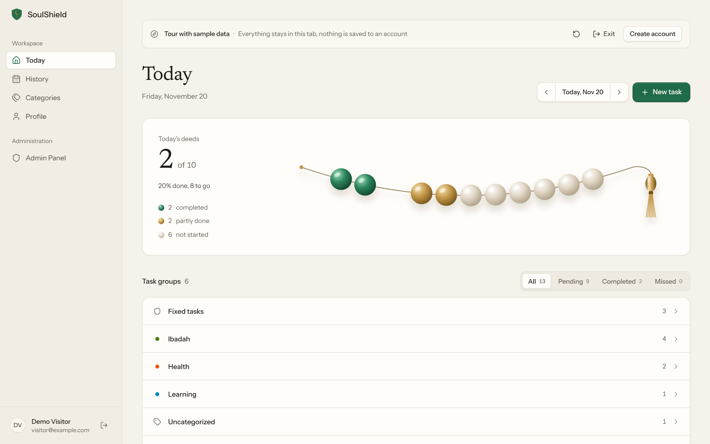
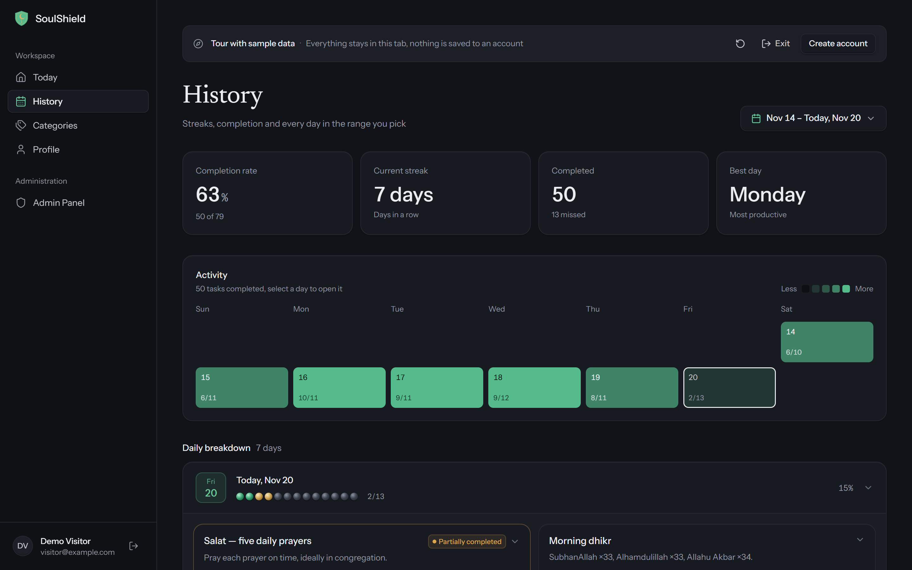
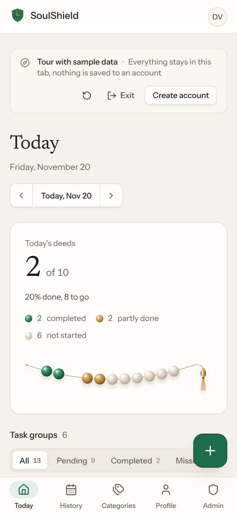

<p align="center">
  
</p>

<h1 align="center">SoulShield 2.0.0</h1>

<p align="center">
  <b>Your daily steps towards Jannah</b><br>
  Track prayers, dhikr, Quran reading and any habit you want to keep, on your phone and on the web.
</p>

<p align="center">
  <a href="https://github.com/Farhan0140/_Soul_Shield/releases/download/v2.0.0/SoulShield-v2.0.0.apk"><b>Download for Android</b></a>
  &nbsp;·&nbsp;
  <a href="https://soul-shield.vercel.app/"><b>Open the web app</b></a>
  &nbsp;·&nbsp;
  <a href="#-quick-start">Quick start</a>
</p>

---

## 📥 Downloads

| | | |
|---|---|---|
| 🤖 **Android app** | `SoulShield-v2.0.0.apk` (in **Assets** below) | Android 7.0 or newer |
| 🌐 **Web app** | [soul-shield.vercel.app](https://soul-shield.vercel.app/) | Any modern browser, no install |
| 📑 **API docs** | [Swagger](https://soul-shield-api.onrender.com/swagger/index.html) | For developers |

One account works everywhere. Sign in on your phone and on the web, and your tasks stay in sync.

> [!TIP]
> Want to look around first? On the web app, press **Take a tour** on the sign-in page. It opens the full app with sample data, no account needed.

## 🌙 What is SoulShield?

SoulShield helps you keep a steady daily routine of worship and self-improvement. You set up your deeds once (Fajr prayer, morning adhkar, ten pages of Quran, a workout), choose which days they repeat, and check them off as you go. Counters handle dhikr, timers handle focused reading, and your history shows how consistent you've been.

The Android app works fully offline. Everything is saved on your phone first and synced in the background when you're back online.

## 📱 The mobile app

**Track your day**
- Three kinds of tasks: **checklist** (done or not), **counter** (e.g. SubhanAllah ×33) and **timer** (e.g. read Quran for 20 minutes)
- Repeat daily, weekly, or on the days you choose
- Break a task into **sub-tasks**, like the five daily prayers under "Salat"
- Organize tasks into color-coded **categories**
- Write your own **reward message** that appears when you finish a task

**Stay on track**
- **Reminders** at the time you pick, if you haven't done the task yet
- **Streaks**, with a small celebration at 3, 7, 14, 30 and 100 days
- **7-day progress chart** and an **Insights** screen (completion rate, best streak, favorite category, most productive day)
- **Share your progress** as an image
- **Home-screen widgets**: today's progress, and a Bluetooth counter widget

**Works anywhere**
- **Offline first**: create, complete and count without a connection, synced later
- **Sync across devices**: change something on the web and your phone updates right away
- Sync status is always visible, with a **Sync issues** screen if anything fails
- **Export your data** as a JSON backup at any time

**Make it yours**
- Light and dark themes, color palettes and UI styles
- English and Bangla interface (Bangla covers the main screens)
- Choice of Arabic font, haptic feedback, focus timer

**Optional: a physical counter button**
- Pair an ESP32 board with a push button over Bluetooth, and every press adds **+1** to your counter, even with the phone locked. See the guide below.

## 🖼️ Screenshots

### Mobile

<p align="center">
  
  &nbsp;
  
  &nbsp;
  
  &nbsp;
  
</p>
<p align="center"><sub>Home · Counter · Insights · Home-screen widget</sub></p>

### Web

<p align="center">
  
</p>
<p align="center"><sub>Today: each finished deed adds a bead to the string</sub></p>

<p align="center">
  
  &nbsp;
  
</p>
<p align="center"><sub>History in dark mode · the web app on a phone</sub></p>

## 📲 Install on Android

1. On your phone, open this page and tap **`SoulShield-v2.0.0.apk`** under **Assets** at the bottom.
2. Open the downloaded file. If Android asks, allow your browser or file manager to **install unknown apps** (Settings → Apps → your browser → Install unknown apps).
3. Tap **Install**, then **Open**.

> [!NOTE]
> The app isn't on the Play Store yet, so Android may show a "Play Protect" or "unknown app" warning. That's expected for apps installed from outside the store. Tap **More details → Install anyway**.

## 🚀 Quick start

1. **Create an account.** Pick a security question too; it's how you reset a forgotten password (there's no email reset).
2. **Add your first task.** Tap **+**, give it a name, choose checklist, counter or timer, and pick the days it repeats.
3. **Set a reminder** (optional) in the same form, so you get a nudge if you forget.
4. **Do your deeds.** Tick checklist tasks, tap counters, or start a timer. Only today's tasks can be completed, so your history stays honest.
5. **Look back.** Open **History** or **Insights** to see streaks and your completion rate.
6. **Add the widget** (optional): long-press your home screen → **Widgets** → **Soul Shield — Today**.

<details>
<summary><b>🔘 Set up the ESP32 counter button (optional)</b></summary>

<br>

You need an ESP32-C3 or ESP32 Dev Module board and a push button.

1. Flash the firmware with PlatformIO: `cd Framework && pio run -t upload` (or `Framework-ESP32-DevModule` for a classic ESP32).
2. Wire the button between **GPIO4** and **GND**, then power the board.
3. In the app, open any counter task, tap the **Bluetooth** icon and choose **SoulShield-ESP32**.
4. Each press now adds +1 to that counter. Switch the active counter any time from a counter page.

The full guide is in [`Framework/README.md`](https://github.com/Farhan0140/_Soul_Shield/blob/main/Framework/README.md).

</details>

## ⚠️ Good to know

- **The first sign-in can take up to a minute.** The server sleeps when nobody is using it and needs a moment to wake up. The app tells you when this is happening, and after that it's fast.
- **Android only for now.** There is no iOS build yet; iPhone users can use the web app.
- **Your data:** you can export everything from the app, and delete your account (with all its data) from Profile at any time.
- **Updates:** download future versions from this Releases page and install over this one. Your data stays on the device and in your account.
- **ESP32 pairing isn't protected.** Any nearby phone with the app can connect to the button. It only sends "+1" presses and holds no account data.

## 🔐 Verify your download (optional)

To check the APK wasn't changed, compare its SHA-256 checksum with this one:

```
SHA-256: <paste checksum here>
```

Windows: `certutil -hashfile SoulShield-v2.0.0.apk SHA256` · macOS/Linux: `shasum -a 256 SoulShield-v2.0.0.apk`

## 💬 Feedback

Found a bug or have an idea? [Open an issue](https://github.com/Farhan0140/_Soul_Shield/issues/new). Screenshots and your Android version help a lot.

---

<sub>© 2026 Farhan. All rights reserved. The source is public for viewing and contributions only, see <a href="https://github.com/Farhan0140/_Soul_Shield/blob/main/LICENSE">LICENSE</a>.</sub>
